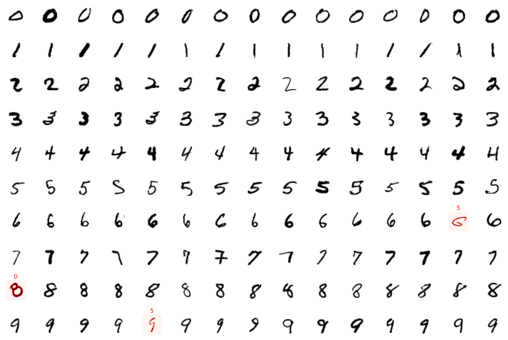
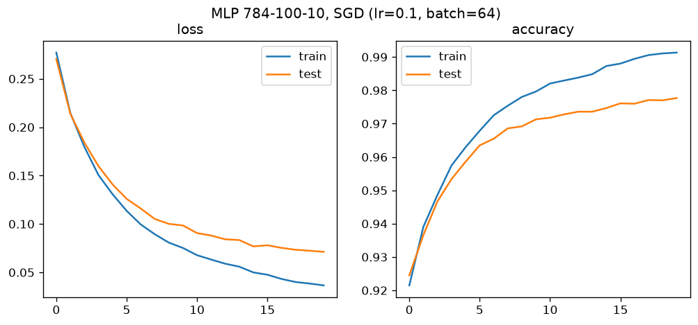

# MNIST project: from the maths to PyTorch

Handwritten digit classification (MNIST, 28×28 images, 10 classes) with a one-hidden-layer neural network.
It is first written entirely by hand from the equations, then each manual part is replaced step by step by its PyTorch equivalent.

## Model

$$\tilde h = X W_1^\top + b_1,\quad h = \tanh(\tilde h),\quad \tilde y = h W_2^\top + b_2,\quad \hat y = \mathrm{softmax}(\tilde y)$$

$$L = -\frac{1}{N}\sum_{i}\sum_{j} y_{ij}\log \hat y_{ij}$$

Gradients derived by hand (backpropagation):

$$\nabla_{\tilde y} = \tfrac{1}{N}(\hat y - y),\quad \nabla_{W_2} = \nabla_{\tilde y}^\top h,\quad \nabla_{\tilde h} = (\nabla_{\tilde y} W_2)\odot(1-h^2),\quad \nabla_{W_1} = \nabla_{\tilde h}^\top X$$

Trained with mini-batch stochastic gradient descent: $\theta \leftarrow \theta - \eta \nabla_\theta L$.

## Steps

| Notebook | Forward | Backward | Update |
|---|---|---|---|
| [v1](v1_manual_forward_backward.ipynb) | matrix products | manual gradients | manual SGD |
| [v2](v2_backward_simplified.ipynb) | matrix products | `autograd` | manual SGD |
| [v3](v3_forward_simplified.ipynb) | `torch.nn` layers | `autograd` | manual SGD |
| [v4](v4_sgd_simplified.ipynb) | `torch.nn` layers | `autograd` | `torch.optim` |

At each step the results are checked against the previous version (manual gradients vs `autograd`, manual SGD vs `torch.optim`).
The training loop and plots are shared in [utils.py](utils.py).

## Results

784-100-10 network, SGD (lr = 0.1, batch = 64), 20 epochs: **97.8% test accuracy**.

